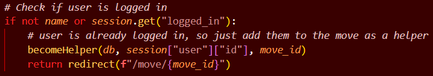
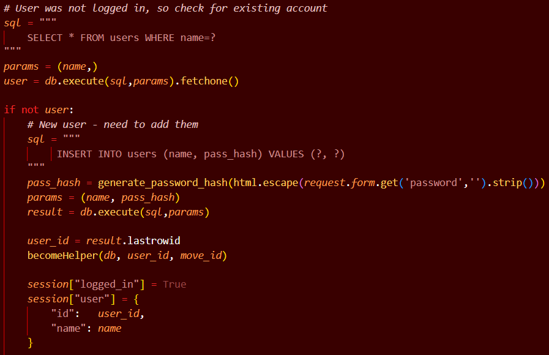
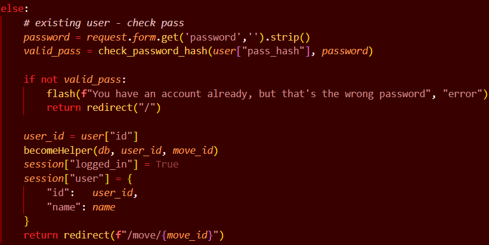
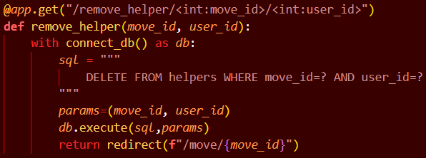
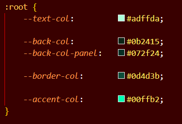

# Project Final Review and Reflection

## Addressing Relevant Implications

### Functionality

During development of the website to ensure it was completely functional I went through every possible situation that a user could have and made it so that the website worked and didn't fall apart. A good example of this is the join route, as there are many scenarios a user could have. For example, a user could be logged in, not logged in and have an account, or not logged in and not have an account, and I ensured and tested (though i didn't manage to document it I dont think) that each one works as intended. unfortunately I wasn't able to meet my second specific requirement because it is outside of the websites control. I'm not very good at this website thing :>

### Usability

Usability is more of the website part by making things easy to understand and use, which I unfortunately didn't really get around to. If I had gotten to that point then I would've coloured my boxes as is in the prototype, with solid colours for "yes" buttons and outlined empty looking boxes for "no". I also would've attempted to organize the layout of my website in a way that was easy to understand to the user, with a clear hierarchy with font sizing and background boxes to help the user understand what parts of a specific page were relevant to each other. For example, the Move page if you were hosting the move, I would've grouped together the admin parts such as the move code, the section which shows all the boxes, and the section which shows all the helpers.

### Accessibility

Accessibility is also apart of the front end of website development, and to address this I would've styled my website in a dynamic way with for example percentage values for sizes so that my website can fit a wide variety of screen ratios for use on both mobile and pc use, as despite the development being done on pc, in actual context it is much more likely for people using my app to be on mobile, as it would be a lot easier to carry around while packing things into boxes. I also would have liked to implement colourblind modes, so that more users could easier access my website, and also alt text on images, however my app doesn't exactly use images, though I could've had it so that you can add images to specific items, but that might use a lot of time to pack things up if the user has to take a photo of each item they pack into boxes, then add alt text themselves. I could have tried to have some sort of AI look at the image and figure out what the item is and add alt text that way, but it sounds difficult, and I'm not too keen on LLMs and training my own also sounds very difficult.

### Privacy

Privacy was addressed by limiting the access of other users to each other at the owners discretion. The helper system allows for other people to access anothers move and make changes to it, however if the owner no longer wishes for someone to help out, then they have the ability to remove that person from the move. To keep any removed helpers from rejoining the move, I also added a system to change the code of the move, so then the original code would no longer work. Also to keep people's data safe, I stored a hash of their password instead of their password in plain text to prevent data leakages.

### Future Proofing

Future proofing is about making the website easy to make changes to and modify in the future. This is important to my web app as moving from house to house often takes place between a few years or so. To make this possible I made the stylesheet use variables to easily modify the colour palette. I also would've liked to have make the pages modular, with the use of divs, but i didn't get around to that.

## Overall Review

Overall, development was going well, but I struggled to complete the project within the generously large timeframe given by my wonderful DTD teacher. I particularly had problems with understanding what exactly everything did, as I am the type of person who likes to understand how something works before I can get proficient with it. I also struggled with css, as it doesn't give any errors, since the way a website looks is purely subjective, so I would've had to spend a lot of time just unproductively messing around with margins, and padding and what not as I struggle to remember any css from last year. If I could've done anything differently, I would've commented my code more as I go, because a solid amount of time wasted was just trying to understand what yesterday Benjamin was creating. Something that went well was my understanding of how the backend part of the website worked, as I made a point to copy minimal code and write most of it myself, and after spending a ton of time getting things working, I would say I have a good understanding of how it all work, and that's worth more than any amount of credits (I'm coping).

